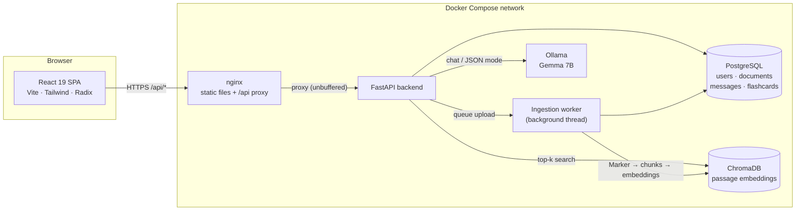
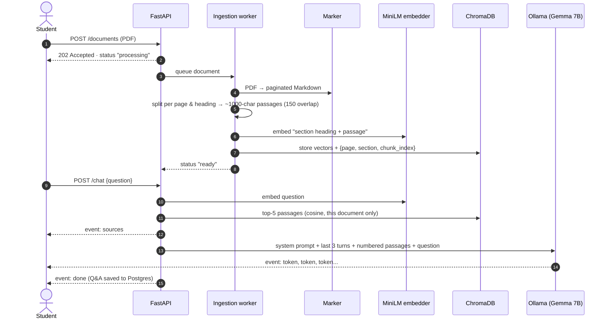

<div align="center">


# Athena AI

**Upload a PDF. Ask it questions. Get answers that cite the page they came from. Turn it into flashcards.**

A self-hosted study assistant built on a local retrieval-augmented generation (RAG) pipeline.
Your documents and questions never leave your machine.


</div>

---

## What it does

Athena AI turns course material into something you can talk to. You drop in a lecture PDF, a paper or a textbook chapter, and Athena:

1. **Reads it properly.** [Marker](https://github.com/datalab-to/marker) converts each page to Markdown with layout detection and OCR, so headings, lists and tables survive and scanned pages still work.
2. **Indexes it.** The text is cut into overlapping passages that never cross a page or section boundary, embedded with `all-MiniLM-L6-v2`, and stored in ChromaDB.
3. **Answers from it.** Each question retrieves the most relevant passages and hands them to a local LLM (Gemma 7B via Ollama). The answer streams back token by token with numbered citations like `[1]`, and you can expand each citation to see the page, section and exact passage it came from.
4. **Quizzes you on it.** Flashcards are generated from passages sampled across the whole document, or from the passages most relevant to a topic you name. You mark each card "Got it" or "Need review", and your progress is saved.

Optional web search (DuckDuckGo) can add outside context. Web results are cited separately as `[W1]`, `[W2]` so you always know what came from your document and what didn't.

## Features

| | |
|---|---|
| **Grounded chat** | Answers cite the retrieved passages; follow-up questions use the last 3 turns of conversation |
| **Live streaming** | Tokens stream over newline-delimited JSON, so you read the answer as it is written |
| **Source inspector** | Every answer lists its passages with page number, section heading and relevance score |
| **Layout-aware parsing** | Marker extracts Markdown with OCR; a fast `pdftext` mode is one setting away |
| **Background ingestion** | Uploads return immediately; parsing runs on a worker and resumes after a restart |
| **Flashcards** | 5–20 cards per set, whole-document or topic-focused, with review tracking |
| **Accounts** | JWT auth with refresh tokens; every document, message and card is scoped to its owner |
| **One-command deploy** | Postgres, Ollama, backend and nginx in Docker Compose, with an NVIDIA GPU override |

## Architecture



The browser only ever talks to nginx. nginx serves the built React app and forwards `/api/*` to the backend with buffering turned off, so streamed answers arrive as they're generated. Because the app and the API share an origin, there is no CORS to configure. In development, Vite's dev server proxies `/api` the same way.

### The RAG pipeline



A few design decisions worth knowing:

- **Chunks respect structure.** The splitter first cuts each page at its Markdown headings, then splits each section into overlapping passages. A passage never spans two pages, so a citation like "page 3 · The Calvin Cycle" is always exact. A page that starts mid-section inherits the heading from the page before.
- **Embeddings carry their heading.** The vector for a passage is computed from `section heading + passage`, which helps short passages get found ("it takes place in the stroma" is much easier to retrieve when the embedding also knows it's about the Calvin cycle). The stored text is the raw passage.
- **Only the current question carries context.** Earlier turns are sent as plain question/answer pairs, so the context window stays small no matter how long the conversation gets.
- **Flashcards cover the whole document.** Without a topic, passages are sampled at even intervals up to a 12,000-character budget, so a 40-page PDF doesn't produce 10 cards about page 1. With a topic, the 20 best-matching passages are used, in reading order. The LLM is constrained to a JSON schema via Ollama's structured outputs.
- **Ingestion is serialized.** Marker's models take several GB of memory, so one worker thread processes uploads in order. Documents interrupted by a restart are picked up again automatically, and a failed one can be retried from the UI.

## Tech stack

**Frontend**: React 19, TypeScript 5.9, Vite 7, Tailwind CSS 4 with the Typography plugin, Radix UI primitives, React Router 7, `react-markdown` + `remark-gfm` for rendering answers, Lucide icons.

**Backend**: FastAPI, SQLAlchemy 2 on PostgreSQL 16, Pydantic 2, `python-jose` JWTs with bcrypt password hashing, Uvicorn.

**AI / RAG**: Marker 1.10 (PDF → Markdown, Surya OCR), LangChain text splitters, sentence-transformers (`all-MiniLM-L6-v2`), ChromaDB 1.3 (persistent, cosine HNSW), Ollama (Gemma 7B by default; any Ollama model works), PyTorch 2.9 (CPU or CUDA 12.8 build), `ddgs` for optional web search.

**Infrastructure**: Docker Compose (5 services, 4 named volumes, health-checked startup order), nginx 1.27, multi-stage frontend image, non-root backend image, NVIDIA GPU override file.

## Quick start (Docker)

You need Docker with Compose v2, about 25 GB of free disk space and 16 GB of RAM. Most of that is models: Gemma 7B is 5.4 GB on disk, Marker's models 3.5 GB, and on CPU the running stack holds about 14 GB in memory (Ollama ~9 GB, the backend ~5 GB with Marker loaded). An NVIDIA GPU is optional but strongly recommended.

```bash
git clone https://github.com/BahaRiahi3/AthenaAI.git
cd AthenaAI

make env     # creates .env with a random DB password and JWT secret
make up      # or: make gpu   (NVIDIA GPU)
```

Then open **http://localhost:3000**, create an account and upload a PDF.

Without `make`:

```bash
cp .env.example .env               # then set DB_PASSWORD and SECRET_KEY
docker compose up -d --build
# GPU: docker compose -f docker-compose.yml -f docker-compose.gpu.yml up -d --build
```

**The first start is slow, once.** The `ollama-pull` job downloads Gemma 7B (5 GB), and the backend downloads Marker's layout and OCR models on boot. Both are cached in Docker volumes, so later starts take seconds. Watch progress with `docker compose logs -f ollama-pull backend`, and check readiness with:

```bash
make health
# {"status":"ok","database":"ok","llm":"ok"}
```

| URL | What |
|---|---|
| http://localhost:3000 | The app |
| http://localhost:8000/docs | Interactive API docs (Swagger UI) |
| http://localhost:8000/health/ready | Readiness of the database and LLM |

### What to expect on performance

Measured with `gemma:7b` on a laptop (20-thread CPU, RTX 4050 with 6 GB VRAM), on a 3-page lecture PDF:

| Step | CPU only | GPU override |
|---|---|---|
| Ingest the PDF (Marker + embeddings) | ~55 s | ~4 s |
| First answer after start (model loads) | ~80 s | ~10 s |
| Time to first token, warm | 20–30 s | ~5 s |
| Embedding + retrieval per question | < 1 s | < 1 s |

On a 6 GB card, Marker's models (~3.5 GB of VRAM) and Gemma 7B (5 GB) don't both fit, so Ollama runs Gemma split 55/45 between CPU and GPU. It still works and is much faster than CPU only. A card with 12 GB or more runs everything on the GPU, and so does a smaller model on a 6 GB card (see [DOCKER.md](DOCKER.md#gpu)). If you're stuck on CPU, a smaller model helps a lot: set `OLLAMA_MODEL=gemma2:2b` or `qwen2.5:3b` in `.env` and run `docker compose up -d`.

## Configuration

Everything is configured through `.env` (see [`.env.example`](.env.example)). The defaults are sensible; only the first two are required.

| Variable | Default | Description |
|---|---|---|
| `DB_PASSWORD` | *(required)* | PostgreSQL password |
| `SECRET_KEY` | *(required)* | JWT signing key (use 32+ random characters) |
| `OLLAMA_MODEL` | `gemma:7b` | Any chat model from the [Ollama library](https://ollama.com/library); pulled automatically |
| `OLLAMA_NUM_CTX` | `8192` | Context window per request (passages + history + answer) |
| `PDF_PARSER` | `marker` | `marker` (layout + OCR, accurate) or `pdftext` (text layer only, very fast) |
| `RETRIEVAL_TOP_K` | `5` | Passages retrieved per question |
| `CHUNK_SIZE` / `CHUNK_OVERLAP` | `1000` / `150` | Passage size and overlap, in characters |
| `MAX_UPLOAD_MB` | `10` | Upload size limit |
| `ACCESS_TOKEN_EXPIRE_MINUTES` | `60` | Access token lifetime (refresh tokens last 7 days) |
| `APP_PORT` / `API_PORT` / `DB_PORT` | `3000` / `8000` / `5433` | Host ports (API and DB bind to localhost only) |

Changed the parser or chunk settings? Existing documents keep their old index until you re-run ingestion: `POST /documents/{id}/reprocess`.

## Local development

Run Postgres and Ollama in Docker and the app on your machine with hot reload:

```bash
make env
./start.sh        # or: make dev
```

`start.sh` starts the `db`, `ollama` and `ollama-pull` containers, creates `backend/venv` on first run (PyTorch first, then `backend/requirements.txt`), and starts Uvicorn with `--reload` on :8000 and Vite on :5173. Vite proxies `/api` to the backend, exactly like nginx does in production.

To run the pieces by hand (from the project root, since `backend` is a Python package):

```bash
docker compose up -d db ollama ollama-pull
source backend/venv/bin/activate
uvicorn backend.main:app --reload --reload-dir backend
npm run dev
```

Useful checks before a commit:

```bash
npm run lint && npm run build     # ESLint + TypeScript + production build
```

## API

All endpoints except signup, login and refresh require `Authorization: Bearer <access token>`. Full schemas are at `/docs`.

| Method | Endpoint | Description |
|---|---|---|
| `POST` | `/auth/signup` | Create an account → `{access, refresh, user}` |
| `POST` | `/auth/login` | Log in → `{access, refresh, user}` |
| `POST` | `/auth/refresh` | Exchange a refresh token for a new pair |
| `POST` | `/documents` | Upload a PDF (multipart `file`) → `202`, status `processing` |
| `GET` | `/documents` | Your documents, newest first |
| `GET` | `/documents/{id}` | One document (poll until `status` is `ready` or `failed`) |
| `POST` | `/documents/{id}/reprocess` | Run ingestion again |
| `DELETE` | `/documents/{id}` | Delete the document, its vectors, messages and flashcards |
| `GET` | `/documents/{id}/messages` | Conversation history, with sources |
| `POST` | `/chat` | Ask a question → NDJSON stream (below) |
| `POST` | `/flashcards/generate` | `{document_id, num_cards, topic?}` → new card set |
| `GET` | `/flashcards/{document_id}` | Current card set |
| `PATCH` | `/flashcards/{card_id}` | `{needs_review}` → record a review |
| `GET` | `/health/live` · `/health/ready` | Liveness · readiness (DB + LLM) |

`POST /chat` takes `{"document_id": "...", "question": "...", "enable_search": false}` and streams one JSON object per line:

```json
{"type": "sources", "sources": [{"text": "...", "page": 3, "section": "The Calvin Cycle", "score": 0.699}], "web": []}
{"type": "token", "content": "The enzyme RuBisCO"}
{"type": "token", "content": " fixes CO2 in the stroma"}
{"type": "done", "message_id": 8}
```

Try it from the terminal:

```bash
TOKEN=$(curl -s localhost:8000/auth/login -H 'Content-Type: application/json' \
  -d '{"email":"you@example.com","password":"your-password"}' | jq -r .access)

DOC=$(curl -s localhost:8000/documents -H "Authorization: Bearer $TOKEN" \
  -F "file=@lecture.pdf;type=application/pdf" | jq -r .id)

curl -N localhost:8000/chat -H "Authorization: Bearer $TOKEN" -H 'Content-Type: application/json' \
  -d "{\"document_id\":\"$DOC\",\"question\":\"Summarize the key ideas\"}"
```

## Project structure

```
AthenaAI/
├── backend/                    FastAPI app (a Python package: run as backend.main:app)
│   ├── main.py                 App setup, lifespan (tables, ingestion worker), health checks
│   ├── config.py               All settings, read from the environment / .env
│   ├── pipeline.py             RAG core: parse → chunk → embed → index → retrieve
│   ├── ingestion.py            Background worker that runs the pipeline on uploads
│   ├── prompts.py              RAG system prompt, context formatting, flashcard prompt + JSON schema
│   ├── llm.py                  Ollama client (chat, streaming, health)
│   ├── vectorstore.py          ChromaDB collection
│   ├── search.py               Optional DuckDuckGo web search
│   ├── models.py / schemas.py  SQLAlchemy tables / Pydantic request & response models
│   ├── auth.py / deps.py       JWT handling, current user, document ownership checks
│   ├── routers/                auth · documents · chat · flashcards
│   ├── requirements.txt        Direct dependencies (PyTorch installed separately)
│   └── Dockerfile              Python 3.12 slim, CPU or CUDA PyTorch, non-root
├── src/                        React app
│   ├── components/             Pages: landing, about, contact, login, signup, chat, flashcards
│   ├── components/ui/          Radix-based primitives (button, card, input, ...)
│   ├── context/auth.tsx        Auth state
│   └── lib/api.ts              Typed API client: token refresh, NDJSON chat streaming
├── docker-compose.yml          db · ollama · ollama-pull · backend · frontend
├── docker-compose.gpu.yml      NVIDIA GPU override
├── Dockerfile                  Frontend: Node 22 build → nginx
├── nginx.conf                  SPA routing, /api reverse proxy, caching, security headers
├── Makefile                    make env · up · gpu · logs · health · clean ...
└── start.sh                    Local development with hot reload
```

## Security notes

- Passwords are hashed with bcrypt; access tokens expire after 60 minutes, refresh tokens after 7 days, and a refresh token can't be used as an access token.
- Every document, message and flashcard query checks ownership. Other users' documents return `404`, so their IDs can't even be probed.
- Uploads are capped in size, checked for the `%PDF` signature, and stored under server-generated UUIDs, never under user-supplied names.
- The API and database ports are published on `127.0.0.1` only. Only nginx (port 3000) is exposed to the network.
- The backend container runs as an unprivileged user.

For an internet-facing deployment, put the stack behind TLS (a reverse proxy like Caddy or Traefik in front of port 3000), use strong secrets, and see [DOCKER.md](DOCKER.md) for backups.

## Troubleshooting

<details>
<summary><b>The backend never becomes healthy</b></summary>

It waits for `ollama-pull` to finish downloading the model. Check `docker compose logs -f ollama-pull`. If the pull failed (network, disk space), run `docker compose up -d` again to retry.
</details>

<details>
<summary><b>A document is stuck on "Processing…"</b></summary>

The first upload after a fresh install waits for Marker's models to download (a few GB). Check `docker compose logs -f backend`. Large PDFs on CPU take a few seconds per page; set `PDF_PARSER=pdftext` for near-instant ingestion of PDFs that have a text layer.
</details>

<details>
<summary><b>"We couldn't process this PDF"</b></summary>

The error is shown in the UI. "No readable text found" usually means a scanned PDF parsed with `PDF_PARSER=pdftext`; switch to `marker` (which runs OCR) and click *Try again*.
</details>

<details>
<summary><b>Answers are slow</b></summary>

Use the GPU override (`make gpu`), or a smaller model (`OLLAMA_MODEL=gemma2:2b`). On CPU, the first question after a restart also pays for loading the model into memory; Ollama keeps it loaded for 30 minutes after that.
</details>

<details>
<summary><b>Port 3000, 8000 or 5433 is already in use</b></summary>

Set `APP_PORT`, `API_PORT` or `DB_PORT` in `.env` and run `docker compose up -d`.
</details>

## Team

Athena AI was built by:

| | |
|---|---|
|  | **Mohamed Baha Riahi** · [LinkedIn](https://www.linkedin.com/in/mohamedbahariahi/) |
|  | **Mohamed Aziz Merichkou** · [LinkedIn](https://www.linkedin.com/in/mohamed-aziz-merichkou-98b1a322a/) |
|  | **Dhia Dachraoui** · [LinkedIn](https://www.linkedin.com/in/dhia-dachraoui-65bb14338/) |
|  | **Omar Chaaar** · [LinkedIn](https://www.linkedin.com/in/omar-chaar-827a03281/) |
